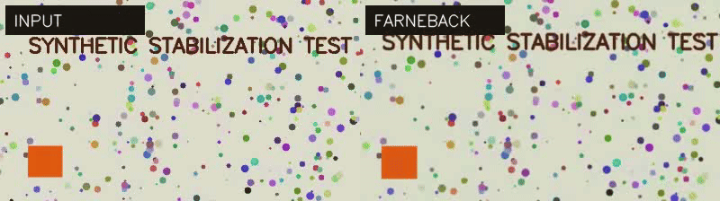
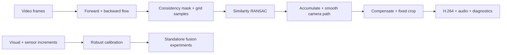

# Visual–Inertial Video Stabilization

**Dense optical flow. Robust motion estimation. Inspectable sensor fusion.**

[](https://github.com/tolegengca/visual-inertial-video-stabilization/actions/workflows/tests.yml)

[](LICENSE)

A research-oriented video stabilization toolkit that makes the motion pipeline observable: estimate dense flow, reject inconsistent matches, fit camera motion, smooth the trajectory, and inspect both the rendered output and its diagnostics.

The repository contains **two explicit tracks**: a working visual stabilization CLI, and separate calibration/fusion modules for studying how visual and inertial estimates can complement each other. The CLI does not silently claim to fuse IMU data.

## See it run



*Reproducible synthetic scene; input on the left, stabilized Farneback output on the right. This demonstrates the pipeline, not performance on arbitrary real-world footage.*

## Engineering highlights

- **Bidirectional flow:** pretrained RAFT-Small or an explicitly selected Farneback backend.
- **Reliable correspondences:** forward/backward consistency and spatial grid sampling before similarity RANSAC.
- **Graceful degradation:** feature tracking, then identity motion, when dense estimates are unreliable; each decision appears in the pair log.
- **Controllable stabilization:** Gaussian trajectory smoothing with separate translation, rotation, and scale strengths.
- **Inspectable output:** H.264 video, optional copied audio, per-pair CSV, trajectory CSV, and JSON diagnostics.
- **Fusion experiments:** robust gyro-to-image calibration, confidence/innovation weighting, and low-frequency visual + high-frequency inertial decomposition.



## Quick start: no model download

Python 3.12 and `ffmpeg` on your PATH are required. Use a virtual environment.

```bash
git clone https://github.com/tolegengca/visual-inertial-video-stabilization.git
cd visual-inertial-video-stabilization
python3 -m venv .venv
source .venv/bin/activate
python -m pip install -r requirements.txt
python scripts/make_test_video.py
mkdir -p results
python stabilize.py data/synthetic_shaky.mp4 results/stabilized.mp4 \
  --backend farneback --working-width 320
```

This generates a short textured scene with known camera perturbations, a moving foreground object, and an audio tone. It requires no private capture data or external weights.

### Use RAFT-Small

```bash
python -m pip install -r requirements-raft.txt
python stabilize.py input.mp4 results/raft.mp4 --backend raft --device auto
```

The first RAFT run downloads torchvision pretrained weights. `auto` selects CUDA when available, otherwise CPU; it does not currently select Apple MPS. RAFT is included as an optional backend and was not executed in the publication validation.

### Control the correction

```bash
python stabilize.py input.mp4 results/custom.mp4 \
  --backend farneback --working-width 480 --sigma 3.3 --radius 10 \
  --translation-strength 1.0 --rotation-strength 0.0 --scale-strength 0.0
```

The defaults correct translation only. Increase other strengths deliberately and inspect the crop and image quality.

## Outputs you can inspect

| Artifact | Purpose |
|---|---|
| `stabilized.mp4` | Rendered H.264 video; source audio is copied when compatible |
| `stabilized_metrics.json` | Backend, dimensions, reliability, crop, modeled jitter, independent feature-tracking diagnostics |
| `stabilized_pairs.csv` | Match reliability, inliers, chosen estimator, translation per frame pair |
| `stabilized_trajectory.csv` | Raw and smoothed translation, rotation, and log-scale |

Modeled path smoothness and feature-tracking residuals are **diagnostics, not perceptual-quality scores**. They can improve while crop, parallax, or moving objects still look poor. See [validation](docs/VALIDATION.md).

## Sensor fusion: a separate experimental interface

```python
from vstab.fusion import robust_sensor_calibration, adaptive_innovation_fusion

# N × 3: sensor angular increments and visual [tx, ty, theta] increments.
sensor_prediction, coefficients, residual_scale, weights = (
    robust_sensor_calibration(sensor_delta, visual_delta, confidence)
)
fused, diagnostics = adaptive_innovation_fusion(
    visual_delta, sensor_prediction, confidence, residual_scale
)
```

Calibration requires correctly aligned input streams. The generic `stabilize.py` CLI does not read IMU logs. `scripts/mi9_fusion_benchmark.py` is a dataset-specific research driver; its private capture dataset is not distributed. A calibrated camera model, timing checks, and independent evaluation are still needed for stronger claims.

## Repository map

```text
vstab/       flow backends, camera motion, rendering, fusion
scripts/     synthetic fixtures and research utilities
tests/       geometry, correspondence, smoothing, calibration, fusion
examples/    sanitized results from the publication smoke test
ios/         separate experimental Swift integration package
```

The standalone [Steady iOS application](https://github.com/tolegengca/steady-ios) is a separate project with its own supported features.

## Verification

```bash
python -m pip install -r requirements-dev.txt
python -m pytest -q
```

See [the exact validation boundary](docs/VALIDATION.md), [architecture](docs/ARCHITECTURE.md), and [third-party acknowledgments](THIRD_PARTY.md). Research code: rolling-shutter correction, lens correction, perceptual superiority, and parity with Gyroflow are not claimed.

Built by [Tolegen Aiteni](https://github.com/tolegengca). [MIT license](LICENSE).
